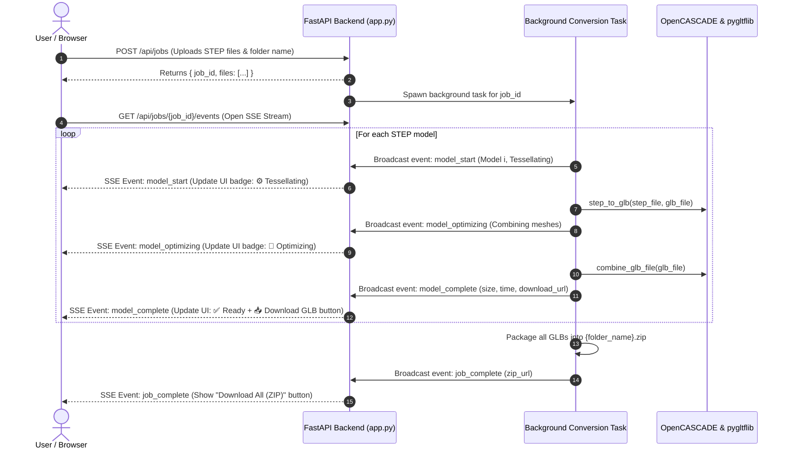

# Implementation Plan: Live Individual Model Conversion Status

## 1. Executive Summary & Goals
- **Goal**: Enable real-time, live progress tracking for every individual STEP model during batch conversion.
- **Key User Experience**:
  - If 10 models are uploaded: The user sees which model is currently converting (e.g., model 3 of 10), which are completed (models 1 & 2), and which are pending (models 4–10).
  - Users can download each converted `.glb` immediately as soon as it finishes, without waiting for the rest of the batch.
  - When the entire batch finishes, a "Download All as ZIP" archive is automatically available.
- **Chosen Architecture**: **Server-Sent Events (SSE) with Background Processing** + Individual GLB endpoints.

---

## 2. System Architecture & Flow

---

## 3. Backend Implementation Specification

### 3.1 Script Modularization
- **[step_to_glb.py](file:///c:/Users/bhavy/HX-Viewer/step-to-glb-converter/step_to_glb.py)**:
  - Refactor `step_to_glb(step_path: Path, glb_path: Path) -> bool` to ensure it cleanly accepts arbitrary paths without relying on global static folder constants.
- **[combine_glb_meshes.py](file:///c:/Users/bhavy/HX-Viewer/step-to-glb-converter/combine_glb_meshes.py)**:
  - Ensure `combine_glb_file(glb_path: Path) -> bool` can be run per-file directly in the pipeline.

### 3.2 FastAPI Endpoints ([app.py](file:///c:/Users/bhavy/HX-Viewer/step-to-glb-converter/app.py))
1. **`POST /api/jobs`**:
   - Generates a unique `job_id` (UUID).
   - Creates isolated staging directories: `jobs/{job_id}/step/` and `jobs/{job_id}/glb/`.
   - Saves uploaded STEP files.
   - Initializes job state in memory (`jobs[job_id]`) with an `asyncio.Queue` for SSE message streaming.
   - Launches `asyncio.create_task(process_job(job_id))`.
   - Returns `{ "job_id": job_id, "files": [...] }`.

2. **`GET /api/jobs/{job_id}/events`**:
   - `StreamingResponse` yielding SSE messages (`text/event-stream`).
   - Streams event data as JSON:
     - `init`: List of files and initial states (`queued`).
     - `model_start`: `{"filename": "part1.step", "index": 1, "total": 10, "stage": "tessellating"}`.
     - `model_optimizing`: `{"filename": "part1.step", "stage": "optimizing"}`.
     - `model_complete`: `{"filename": "part1.step", "glb_name": "part1.glb", "size": 1048576, "download_url": "/api/jobs/{job_id}/download-model?file=part1.glb"}`.
     - `model_error`: `{"filename": "part1.step", "error": "Detailed error string"}`.
     - `job_complete`: `{"zip_url": "/api/jobs/{job_id}/download-zip", "successful": 9, "failed": 1}`.

3. **`GET /api/jobs/{job_id}/download-model?file={filename}`**:
   - Returns individual converted GLB (`FileResponse`) with appropriate headers for direct download.

4. **`GET /api/jobs/{job_id}/download-zip`**:
   - Returns the complete zip archive of all converted models.

5. **Session Cleanup**:
   - Background routine or timeout to clean up stale `jobs/{job_id}` directories after 2 hours.

---

## 4. Frontend Implementation Specification ([index.html](file:///c:/Users/bhavy/HX-Viewer/step-to-glb-converter/index.html))

### 4.1 UI Design & Components
- **Dropzone Area**: Modern dashed drag-and-drop zone with folder selection support (`webkitdirectory`).
- **Overall Conversion Header**:
  - High-level progress bar with percentage (`X / Y completed - Z%`).
  - Active status indicator (e.g., `Converting model 3 of 10: base_bracket.step`).
  - Overall time elapsed and completion notice.
- **Real-Time Per-Model Grid / Table**:
  - **File Name**: With icon and original file size.
  - **Status Badge**:
    - ⏳ `Queued` (Subtle grey)
    - ⚙️ `Tessellating (STEP → GLB)` (Pulsing amber/blue)
    - 🔄 `Optimizing Meshes` (Pulsing purple)
    - ✅ `Ready` (Vibrant green with GLB file size)
    - ❌ `Failed` (Red badge with tooltip for error details)
  - **Action Column**:
    - Instant **Download GLB** button per row (enabled as soon as that file reaches `Ready`).
- **Batch Actions Bar**:
  - **"Download All as ZIP"** button (primary action, active when at least one model is converted).
  - **"Reset / Convert More"** button.

---

## 5. Verification & Testing Checklist
- [ ] **Single Model Upload**: Check that stages transition correctly and individual download works.
- [ ] **Multi-Model Batch (5–10 models)**:
  - Verify that when model #3 is converting, models #1 and #2 show ✅ Ready with download buttons, and models #4–#10 show ⏳ Queued.
  - Verify that overall progress bar updates accurately (e.g., 10%, 20%, 30%...).
- [ ] **Fault Tolerance**:
  - Test with a corrupted/invalid STEP file.
  - Ensure the invalid file is marked ❌ Failed while other models continue converting uninterrupted.
- [ ] **ZIP Download**:
  - Ensure the final ZIP contains all successfully converted GLBs.
